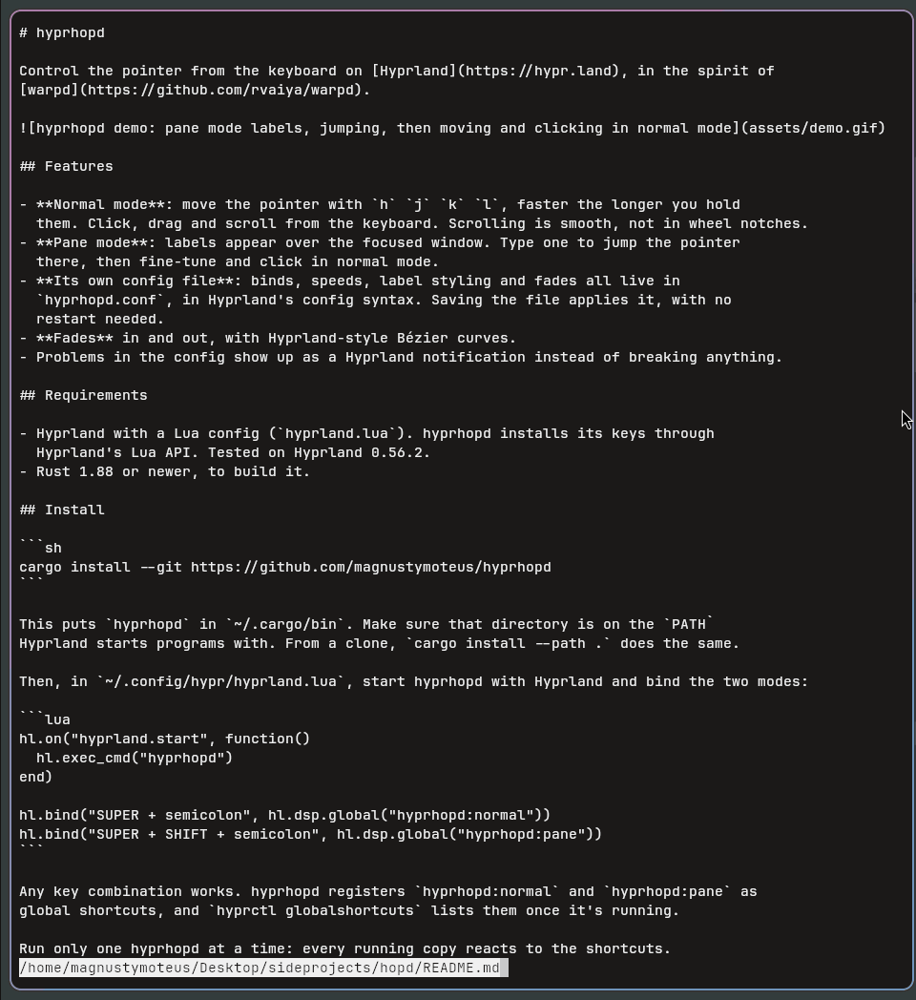

# hyprhopd

Control the pointer from the keyboard on [Hyprland](https://hypr.land), in the spirit of
[warpd](https://github.com/rvaiya/warpd).



## Features

- **Normal mode**: move the pointer with `h` `j` `k` `l`, faster the longer you hold
  them. Click, drag and scroll from the keyboard. Scrolling is smooth, not in wheel notches.
- **Pane mode**: labels appear over the focused window. Type one to jump the pointer
  there, then fine-tune and click in normal mode.
- **Window mode**: a label on every window you can see, on every monitor. Type one to
  focus that window.
- **Its own config file**: binds, speeds, label styling and fades all live in
  `hyprhopd.conf`, in Hyprland's config syntax. Saving the file applies it, with no
  restart needed.
- **Fades** in and out, with Hyprland-style Bézier curves.
- Problems in the config show up as a Hyprland notification instead of breaking anything.

## Requirements

- Hyprland with a Lua config (`hyprland.lua`). hyprhopd installs its keys through
  Hyprland's Lua API. Tested on Hyprland 0.56.2.
- libxkbcommon, which every Hyprland system already has.
- Rust 1.89 or newer, to build it from source.

## Install

### Prebuilt binary

[Releases](https://github.com/magnustymoteus/hyprhopd/releases) have archives for
x86_64 and aarch64 (glibc 2.35 or newer). Each one holds the `hyprhopd` binary, this
README, the license and the example config. To check and install one:

```sh
sha256sum -c hyprhopd-v0.1.0-x86_64-linux.tar.gz.sha256
tar -xzf hyprhopd-v0.1.0-x86_64-linux.tar.gz
install -Dm755 hyprhopd-v0.1.0-x86_64-linux/hyprhopd ~/.local/bin/hyprhopd
```

Make sure `~/.local/bin` is on the `PATH` Hyprland starts programs with.

### From source

```sh
cargo install --git https://github.com/magnustymoteus/hyprhopd
```

This puts `hyprhopd` in `~/.cargo/bin`. Make sure that directory is on the `PATH`
Hyprland starts programs with. From a clone, `cargo install --path .` does the same.

### Starting it

Then, in `~/.config/hypr/hyprland.lua`, start hyprhopd with Hyprland and bind its modes:

```lua
hl.on("hyprland.start", function()
  hl.exec_cmd("hyprhopd")
end)

hl.bind("SUPER + semicolon", hl.dsp.global("hyprhopd:normal"))
hl.bind("SUPER + SHIFT + semicolon", hl.dsp.global("hyprhopd:pane"))
hl.bind("SUPER + apostrophe", hl.dsp.global("hyprhopd:window"))
```

Any key combination works. hyprhopd registers `hyprhopd:normal`, `hyprhopd:pane` and
`hyprhopd:window` as global shortcuts, and `hyprctl globalshortcuts` lists them once it's
running.

Only one hyprhopd runs per Hyprland session: starting it again replaces the running copy,
so after updating, running `hyprhopd` once more switches to the new version.

## Usage

### Normal mode

| Key | Action |
|---|---|
| `h` `j` `k` `l` | Move left, down, up, right. Hold two for diagonals |
| `m` | Left button: held while the key is held, so `m` + `hjkl` drags |
| `,` | Middle button |
| `.` | Right button |
| `e` / `r` | Scroll down / up |
| `Escape` | Leave normal mode |

While normal mode is on, other keys do nothing. These are the defaults; every key can be
rebound, see [Binds](#binds).

### Pane mode

1. Labels appear over the focused window, and typed letters change colour.
2. Labels that no longer match disappear. `Backspace` takes a letter back.
3. When a label is complete, the pointer jumps to it and normal mode starts, ready to
   click or fine-tune.

`Escape` cancels without moving. Pane mode also cancels if its window closes, moves to
another workspace, or changes fullscreen or floating state.

### Window mode

1. A label appears at the centre of every window you can see, on every monitor. Typing and
   `Backspace` work as in pane mode.
2. When a label is complete, that window gets the focus and the pointer moves to its
   centre.

Windows you can see are those on each monitor's current workspace. If a special workspace
is open on a monitor, only its windows get labels there; if a window is fullscreen or
maximized, only that one does. Background tabs of a group get none.

`Escape` cancels. Window mode also cancels if any window opens, closes, moves or changes
fullscreen or floating state, or if a workspace or monitor changes.

## Configuration

hyprhopd reads `$XDG_CONFIG_HOME/hypr/hyprhopd.conf`, which is usually
`~/.config/hypr/hyprhopd.conf`. Without the file, the defaults below apply.

The syntax is Hyprland's own (hyprlang): `name = value`, `section { … }`, `# comments`,
`$variables` and `source = other.conf`. A modest showcase is in
[`examples/hyprhopd.conf`](examples/hyprhopd.conf).

**Live reload:** saving the file applies it. An active normal mode keeps its keys and
speeds until you leave it.

**Mistakes:**
- A bad value, an unknown option or an unknown key name is skipped with a warning, and
  that setting keeps its default.
- A syntax error, such as a missing `}`, keeps the whole previous config.
- Each load with problems prints them and shows one Hyprland notification.

### Binds

```
normal {
    bind = MODS, key, action
}
```

- `MODS` is empty or space-separated, like `SHIFT` or `SHIFT CTRL`.
- `key` is a Hyprland key name, like `h`, `comma` or `escape`.
- Binding an action replaces its default key. Actions you don't bind keep theirs.
- An action can have several binds.
- If Hyprland rejects every key you gave an action, its default comes back with a warning.

| Action | Default key |
|---|---|
| `left` | `h` |
| `down` | `j` |
| `up` | `k` |
| `right` | `l` |
| `scroll_down` | `e` |
| `scroll_up` | `r` |
| `button_left` | `m` |
| `button_middle` | `comma` |
| `button_right` | `period` |
| `exit` | `escape` |

Pane and window mode's `Escape` and `Backspace` are fixed for now.

### Normal mode options

| Option | Default | Meaning |
|---|---|---|
| `normal:speed:initial` | `220` | Pointer speed when a key is pressed, in px/s. Must be > 0 |
| `normal:speed:acceleration` | `700` | Added per second while held, in px/s². `0` keeps the speed constant |
| `normal:speed:max` | `1600` | Speed cap, in px/s. Raised to `initial` if lower |
| `normal:scroll_speed:initial` | `300` | Scrolling speed, in scroll units per second |
| `normal:scroll_speed:acceleration` | `1600` | As for the pointer |
| `normal:scroll_speed:max` | `9000` | As for the pointer |

`normal:speed:initial` is written as nested sections:

```
normal {
    speed {
        initial = 220
    }
}
```

### Pane mode options

| Option | Default | Meaning |
|---|---|---|
| `pane:spacing` | `60` | Distance between label centres, in px. At least `10` |
| `pane:chars` | `abcdefghijklmnopqrstuvwxyz` | Label characters, in the order labels use them. At least two, no repeats or spaces |
| `pane:font:family` | system monospace | A font family name, like `JetBrains Mono` |
| `pane:font:size` | `14` | In px |
| `pane:font:weight` | `bold` | `thin`, `extralight`, `light`, `normal`, `medium`, `semibold`, `bold`, `extrabold`, `black`, or a number from 1 to 1000 |
| `pane:label:text_color` | `rgba(ffffffff)` | Label text |
| `pane:label:typed_color` | `rgba(f9e2afff)` | Letters already typed |
| `pane:label:background` | `rgba(1e1e2ecc)` | Label background |
| `pane:label:padding` | `1 4` | `all`, or `vertical horizontal`, in px |
| `pane:label:radius` | `0` | Corner radius in px. Large values give a pill shape |
| `pane:label:border:width` | `0` | Border width in px. `0` means no border |
| `pane:label:border:color` | `rgba(ffffff40)` | Border colour |
| `pane:backdrop:color` | `rgba(00000000)` | Dims the target window behind the labels. Transparent means off. Its corners follow Hyprland's `decoration:rounding` |

Labels all have the same length: the shortest that gives every point its own label.

### Window mode options

Window mode looks like pane mode: every option you don't set in a `window` section comes
from `pane`, defaults included. The `window` section takes the same options as `pane`,
except `spacing`: `window:chars`, `window:font:size`, `window:label:radius`,
`window:backdrop:color` and so on. Set only what should differ. For example, bigger labels
for bigger targets:

```
window {
    font {
        size = 20
    }
}
```

An invalid `window` value is skipped with a warning and keeps pane mode's value. The
backdrop dims every labelled window.

### Animations

| Option | Default | Meaning |
|---|---|---|
| `animations:bezier` | none | `name, x1, y1, x2, y2`, as in Hyprland. `x1` and `x2` must be between 0 and 1. Can be repeated |
| `animations:pane_in:duration` | `0` | Pane mode fade-in, in ms. `0` is instant |
| `animations:pane_in:curve` | `ease_out` | `linear`, `ease_out`, or a defined bezier |
| `animations:pane_out:duration` | `0` | Fade-out, in ms |
| `animations:pane_out:curve` | `ease_out` | As above |
| `animations:window_in:duration` | `pane_in`'s | Window mode fade-in, in ms |
| `animations:window_in:curve` | `pane_in`'s | As above |
| `animations:window_out:duration` | `pane_out`'s | Window mode fade-out, in ms |
| `animations:window_out:curve` | `pane_out`'s | As above |

Each `window_in` / `window_out` field you don't set comes from the matching `pane_in` /
`pane_out` field, so window mode fades like pane mode unless you say otherwise.

hyprhopd turns off Hyprland's own layer animations for its overlays, so these are the only
fades. Picking a label jumps or focuses right away; the labels fade out afterwards.

### Colours

`rgba(RRGGBBAA)`, `rgba(r, g, b, a)` with `a` between 0 and 1, and `rgb(RRGGBB)`.
Hyprland's `0xAARRGGBB` form isn't supported yet.

## License

BSD-3-Clause, see [LICENSE](LICENSE).
